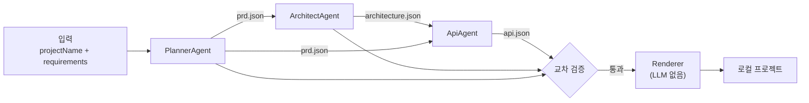

# agents.md

요구사항이 들어왔을 때 실행되는 파이프라인과 각 서브에이전트의 역할을 정의합니다.
**LLM은 정해진 JSON만 만들고, 코드와 문서는 렌더러(LLM 없음)가 템플릿으로 만듭니다.**

## 파이프라인



| 단계 | 담당 | 입력 | 출력 | 스키마 |
|---|---|---|---|---|
| 1 | PlannerAgent | 요구사항 원문 | `prd.json` | `schemas/prd.schema.json` |
| 2 | ArchitectAgent | `prd.json` | `architecture.json` | `schemas/architecture.schema.json` |
| 3 | ApiAgent | `prd.json`, `architecture.json` | `api.json` | `schemas/api.schema.json` |
| 4 | 교차 검증 | 1~3의 JSON | 통과 / 오류 목록 | `rules.md` "교차 검증 규칙" |
| 5 | Renderer | 1~3의 JSON + `templates/` | 프로젝트 파일 | `templates/<이름>/template.json` |

## 공통 규칙

- **시스템 프롬프트** = `skills/<에이전트>.md` + `rules.md`의 "에이전트 공통 규칙" 섹션.
- **사용자 메시지** = 입력 데이터(JSON 또는 요구사항 원문)만 넣습니다. 지시문을 섞지 않습니다.
- **출력** = 해당 스키마를 따르는 JSON 하나. 설명 문장이나 코드 블록 표시(```)를 붙이지 않습니다.
- **모델 설정**: `temperature: 0`, `seed: 42` (지원하는 모델에서만).
- **스키마 강제**: 모델이 지원하면 structured output(JSON Schema 지정)을 사용합니다.

## 실패 처리

1. JSON 파싱 실패, 스키마 검증 실패, 교차 검증 실패 시 **같은 에이전트에 최대 2번 재요청**합니다.
2. 재요청 메시지에는 원래 입력 + 직전 출력 + 오류 목록을 넣습니다.
3. 3번 모두 실패하면 파이프라인을 멈추고 오류를 사용자에게 보여줍니다. 일부만 생성하지 않습니다.

## 캐시

- 캐시 키 = `sha256(projectName + "\n" + requirements + "\n" + 템플릿 버전)`
- 캐시에 있으면 1~3단계를 건너뛰고 저장된 JSON으로 렌더링합니다. **같은 입력이 같은 결과를 내는 것을 보장하는 장치는 이것입니다.**

## 서브에이전트

### PlannerAgent

- **역할**: 요구사항 원문을 기획서(PRD)로 구조화합니다.
- **프롬프트**: `skills/planner.md`
- **하지 않는 것**: 엔티티, 테이블, API 설계.

### ArchitectAgent

- **역할**: PRD의 기능을 만족하는 도메인 엔티티와 관계를 설계합니다.
- **프롬프트**: `skills/architect.md`
- **하지 않는 것**: 패키지 구조, 프레임워크 선택(템플릿이 정함), API 경로 설계.

### ApiAgent

- **역할**: 엔티티마다 REST 리소스 경로와 필요한 작업(LIST/GET/CREATE/UPDATE/DELETE)을 정합니다.
- **프롬프트**: `skills/api.md`
- **하지 않는 것**: 엔티티 수정, CRUD 외 커스텀 엔드포인트(템플릿 v1에서는 지원하지 않음).
