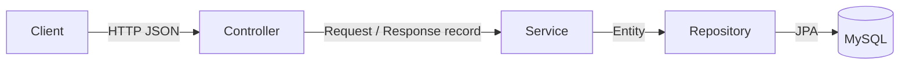
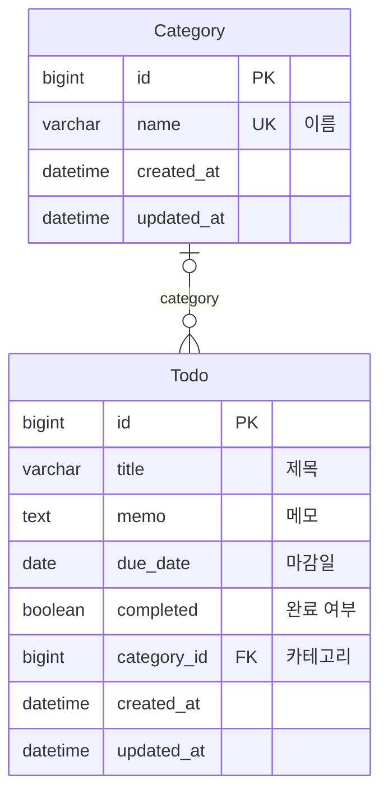

# 할 일 관리 서비스 아키텍처

> project-generator 템플릿 `spring-boot` v1.0.0로 생성된 문서입니다.

## 기술 스택

| 구분 | 기술 |
|---|---|
| 언어 | Java 21 |
| 프레임워크 | Spring Boot 3.5.6 (Web, Data JPA, Validation) |
| 데이터베이스 | MySQL |
| 빌드 | Gradle (Kotlin DSL) |

## 레이어 구조



## 패키지 구조

```
com.generated.todoservice
├── Application.java
├── common
│   ├── GlobalExceptionHandler.java
│   └── NotFoundException.java
├── category
│   ├── Category.java
│   ├── CategoryController.java
│   ├── CategoryRepository.java
│   ├── CategoryRequest.java
│   ├── CategoryResponse.java
│   └── CategoryService.java
└── todo
    ├── Todo.java
    ├── TodoController.java
    ├── TodoRepository.java
    ├── TodoRequest.java
    ├── TodoResponse.java
    └── TodoService.java
```

## ER 다이어그램



## 엔티티

### Category (카테고리)

할 일을 분류하는 기준입니다. (예: 업무, 개인)

- 테이블: `category`
- 관련 기능: F-005, F-006

| 필드 | 컬럼 | 타입 | 필수 | 고유 | 설명 |
|---|---|---|---|---|---|
| `id` | `id` | LONG | O | O | 식별자 |
| `name` | `name` | STRING | O | O | 이름 |
| `createdAt` | `created_at` | DATETIME | O | - | 생성 시각 |
| `updatedAt` | `updated_at` | DATETIME | O | - | 수정 시각 |

### Todo (할 일)

사용자가 해야 할 일 하나입니다.

- 테이블: `todo`
- 관련 기능: F-001, F-002, F-003, F-004, F-006

| 필드 | 컬럼 | 타입 | 필수 | 고유 | 설명 |
|---|---|---|---|---|---|
| `id` | `id` | LONG | O | O | 식별자 |
| `title` | `title` | STRING | O | - | 제목 |
| `memo` | `memo` | TEXT | - | - | 메모 |
| `dueDate` | `due_date` | DATE | - | - | 마감일 |
| `completed` | `completed` | BOOLEAN | O | - | 완료 여부 |
| `category` | `category_id` | → Category | - | - | 카테고리 |
| `createdAt` | `created_at` | DATETIME | O | - | 생성 시각 |
| `updatedAt` | `updated_at` | DATETIME | O | - | 수정 시각 |
